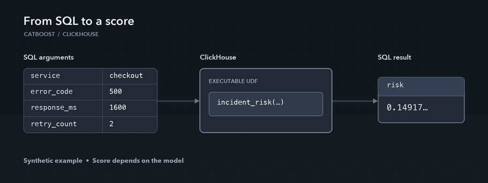

# CatBoost ClickHouse UDF SDK

Run CatBoost predictions in ClickHouse SQL. The SDK checks a trained model and its feature manifest, then packages them with a Python worker for an executable user-defined function (UDF).

After you configure the UDF, call it from a query:

```sql
SELECT incident_risk(
    CAST('checkout', 'Nullable(String)'),
    CAST('500', 'Nullable(String)'),
    CAST(1600, 'Nullable(Float64)'),
    CAST(2, 'Nullable(Float64)')
) AS risk;
```



[View the static diagram](docs/images/readme-flow-static.png).

This example uses a classifier trained on synthetic data. Its score is not a real incident probability.

## Get started

To train the example model, configure a local ClickHouse server, and run the query above, follow the [quickstart](docs/quickstart.md).

To package your own model, install the SDK from a local copy of this repository:

```bash
python -m pip install -e .
```

Then provide a CatBoost `.cbm` file and a [feature manifest](docs/reference.md#manifest):

```bash
catboost-ch inspect --model model.cbm --manifest manifest.json
catboost-ch build --model model.cbm --manifest manifest.json --output model-udf.zip
```

The ZIP contains the model, manifest, worker, and a CatBoost dependency requirement. Configure the UDF on your ClickHouse server before calling it. Building the ZIP does not deploy it. See [Package a model for ClickHouse Cloud](docs/package-model.md).

## Documentation

- [Overview](docs/overview.md): how the UDF works and supported models.
- [Use cases](docs/use-cases.md): examples of predictions in SQL.
- [Tutorials](docs/tutorials.md): local deployment, FileLog, and a synthetic incident scenario.
- [Reference](docs/reference.md): CLI, manifest, bundle, and worker protocol.
- [Contributing](CONTRIBUTING.md): run the project tests.

## Project status

This is an independent prototype. The local demo has been tested with Python 3.11, CatBoost 1.2.10, clickhousectl 0.6.0, and ClickHouse 26.10.6.18 on macOS ARM64. The generated archive has not been tested in ClickHouse Cloud.

## License

The SDK is available under the [MIT License](LICENSE). See [Licenses and trademarks](docs/licensing.md) for third-party dependencies and trademark information. This project is not affiliated with or endorsed by CatBoost or ClickHouse, Inc.
