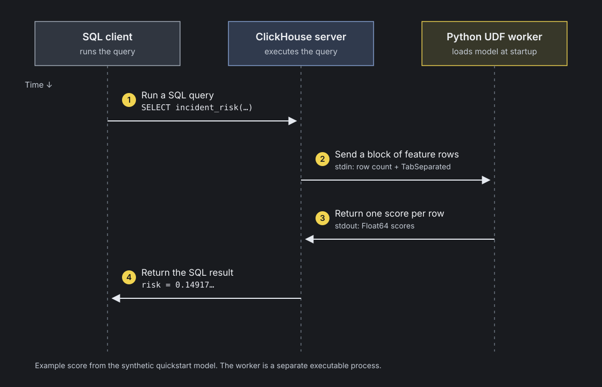

# Overview

This SDK packages a trained CatBoost model for use as an executable user-defined function (UDF) in ClickHouse. After you configure the UDF, you can call it from a SQL query. The SDK does not train your model or deploy the function. The example scripts train models on synthetic data.

## How scoring works



[View the full-size architecture diagram](images/architecture.svg).

1. A model owner trains a CatBoost model and saves it as a `.cbm` file.
2. The owner writes a JSON manifest with the feature names, types, and order used by the model.
3. `catboost-ch inspect` checks the manifest against the model. `catboost-ch build` writes a ZIP containing the model, manifest, worker, and dependency requirement.
4. A user configures an executable UDF using the archive or the local demo tools.
5. ClickHouse sends blocks of rows to a worker process. The worker loads the model at startup, scores each block, and returns one value per row.

The worker uses the `executable_pool` function type. Each process loads its own model copy, so pool size affects memory use. ClickHouse also serializes rows and communicates with the worker through standard input and output. Measure the cost on representative data before choosing this integration.

## Example: score a service event

After you configure the example UDF, you can call `incident_risk` in a query. Pass one value for each feature in the manifest, in the same order:

```sql
SELECT incident_risk(
    CAST('checkout', 'Nullable(String)'),
    CAST('500', 'Nullable(String)'),
    CAST(1600, 'Nullable(Float64)'),
    CAST(2, 'Nullable(Float64)')
) AS risk;
```

The arguments represent a service, an HTTP status code, a response time in milliseconds, and a retry count. The function returns one `Float64` score for the event. For the sample classifier, the score is the predicted probability of class `1` under the synthetic model. It is not an estimate of real incident risk.

To configure the example UDF locally and run this query, follow the [quickstart](quickstart.md).

## Supported models and inputs

The SDK supports binary classification and scalar regression models with numeric and categorical features. For classification, it returns the probability of the manifest's selected positive class. For regression, it returns the raw prediction. See the [reference](reference.md) for the accepted regression objectives and input rules.

The SDK does not support ranking, multiclass output, multi-output regression, text features, or embeddings. It does not manage a model registry, deploy to ClickHouse Cloud, provide rollback, or guarantee throughput.

## Choose this approach

Use a UDF when the features are already in ClickHouse and you want to score rows in SQL. A SQL expression may be enough for a simple rule. A separate inference service may fit better when application requests need a prediction without a database query.

The local demo has been tested on macOS ARM64. The generated ZIP archive has not been tested in ClickHouse Cloud. Test your own model, data, and deployment environment before relying on its predictions.

Start with the [quickstart](quickstart.md) or read the [use cases](use-cases.md).

## Related content

- [Executable user-defined functions](https://clickhouse.com/docs/reference/functions/regular-functions/udf) in the ClickHouse SQL reference.
- [User-defined functions in Cloud](https://clickhouse.com/docs/products/cloud/features/sql-console-features/user-defined-functions).
