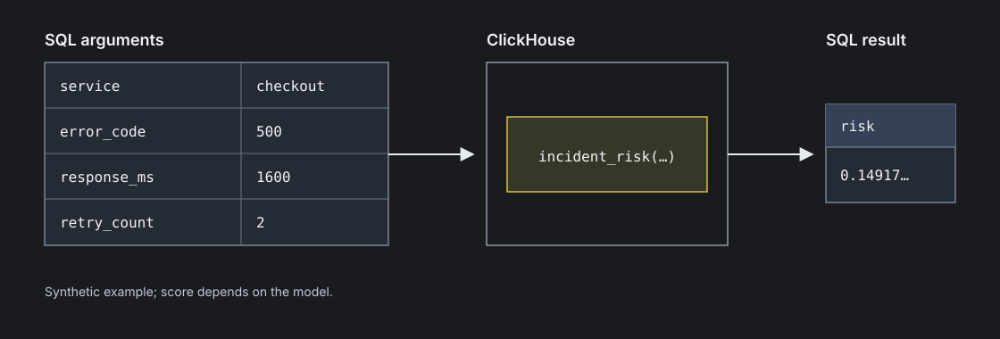

# Quickstart: score a row in ClickHouse

Train a classifier on synthetic service logs, package it as an executable user-defined function (UDF), and call the UDF from a SQL query on a local ClickHouse server.

The data and labels are synthetic. The model is for an integration demo, not real incident decisions.



[View the full-size quickstart diagram](images/quickstart.svg).

## Prerequisites

- Python 3.11 and a terminal on macOS or Linux.
- An internet connection to install dependencies and download ClickHouse.
- A local copy of this repository. Run the commands from the project root.

## Install the SDK

1. Create and activate a virtual environment.

   ```bash
   python3.11 -m venv .venv
   source .venv/bin/activate
   ```

2. Install the SDK and local demo tools.

   ```bash
   python -m pip install -e '.[demo]'
   ```

3. Check that the CLI is available.

   ```bash
   catboost-ch --help
   ```

   The help lists the `inspect` and `build` commands.

## Train and inspect the model

The commands in this section replace files with the same names under `dist/quickstart`.

1. Train the sample classifier.

   ```bash
   python examples/train_demo_model.py --output-dir dist/quickstart
   ```

   The script prints a validation AUC and writes `dist/quickstart/incident-risk.cbm` and `dist/quickstart/validation-logs.tsv`. The AUC describes only the generated data.

2. Check the model and its manifest.

   ```bash
   catboost-ch inspect \
     --model dist/quickstart/incident-risk.cbm \
     --manifest examples/incident-risk.manifest.json
   ```

   The response includes the function name, arguments, return type, and UDF configuration:

   ```json
   {
     "function_name": "incident_risk",
     "arguments": [
       {"name": "service", "type": "Nullable(String)"},
       {"name": "error_code", "type": "Nullable(String)"},
       {"name": "response_ms", "type": "Nullable(Float64)"},
       {"name": "retry_count", "type": "Nullable(Float64)"}
     ],
     "return_type": "Float64",
     "udf_type": "executable_pool",
     "runtime": "python3.11",
     "format": "TabSeparated",
     "send_chunk_header": true,
     "deterministic": true,
     "task": "binary_classification",
     "model_version": "1.0.0"
   }
   ```

## Create the bundle

Run the build command:

```bash
catboost-ch build \
  --model dist/quickstart/incident-risk.cbm \
  --manifest examples/incident-risk.manifest.json \
  --output dist/quickstart/incident-risk-udf.zip
```

The CLI prints the path to the new ZIP archive. The archive contains `main.py`, `model.cbm`, `manifest.json`, and `requirements.txt`. The requirements file pins the CatBoost version installed in this environment. You do not need a ClickHouse server to build the ZIP.

## Configure the UDF on a local server

The following commands start a server named `quickstart` in this project. Use a new server name if one already exists. `DO_NOT_TRACK=1` disables clickhousectl telemetry in this shell.

1. Prepare the files used by `clickhousectl`:

   ```bash
   python scripts/prepare_local_udf.py \
     --model dist/quickstart/incident-risk.cbm \
     --manifest examples/incident-risk.manifest.json \
     --output-dir dist/quickstart
   ```

   The script rebuilds the ZIP at the same path and creates `dist/quickstart/local-udfs/incident_risk/`.

2. Start the local server. The first start downloads ClickHouse and creates a project-specific `.clickhouse` directory:

   ```bash
   export DO_NOT_TRACK=1
   clickhousectl local clickhouse start quickstart --version 26.10.6.18
   ```

3. Configure the `incident_risk` UDF on the server:

   ```bash
   clickhousectl local udf deploy incident_risk \
     --server quickstart \
     --dir dist/quickstart/local-udfs \
     --python "$PWD/.venv/bin/python"
   ```

   The deploy command loads the UDF on the local server. The SDK's `build` command creates the archive but does not deploy the UDF.

## Call the UDF from SQL

Connect to the local server:

```bash
clickhousectl local client quickstart
```

Run this query in the ClickHouse client:

```sql
SELECT incident_risk(
    CAST('checkout', 'Nullable(String)'),
    CAST('500', 'Nullable(String)'),
    CAST(1600, 'Nullable(Float64)'),
    CAST(2, 'Nullable(Float64)')
) AS risk;
```

The arguments represent the service, HTTP status code, response time in milliseconds, and retry count. The response contains one numeric score between 0 and 1. For example:

```text
0.1491715293479955
```

The exact value depends on the trained model. The model and labels are synthetic, so the score is not a real incident probability.

To use the function with a table, pass columns to `incident_risk` in the same order. See the queries in [incident-risk.sql](../examples/incident-risk.sql).

Type `exit` to leave the ClickHouse client. To stop the local server, run:

```bash
clickhousectl local clickhouse stop quickstart
```

To load and score a sample table, follow [Run the local demo](local-demo.md). To package your own model for ClickHouse Cloud, follow [Package a model for ClickHouse Cloud](package-model.md). The archive has not been tested in ClickHouse Cloud.
